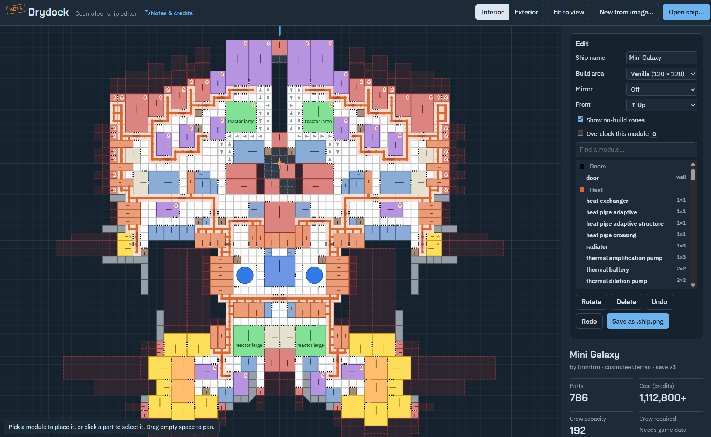

# Drydock (beta)

A free, browser-based ship editor for **Cosmoteer: Starship Architect & Commander**. Open a ship `.png`, inspect it, rebuild it, or start a brand-new hull from any picture, then save it straight back into a file the game can load. Use the online link or save the .html and use offline!

**[Open Drydock →](https://viperg.github.io/Drydock/)**

Nothing to install, and nothing is uploaded: Drydock runs entirely in your browser, and your ship files never leave your computer.

## What it does

**View any ship**
- Open a ship `.png` by dragging it in or using **Open ship…**
- Interior and exterior views, with color-coded modules, doors, heat-pipe networks and slanted armor drawn at their real angles
- Hover any module or door for details
- Stats: part count, cost, crew capacity, footprint, mass and overclocked modules

**Edit it**
- Searchable module list; click a module, then click to place it
- Move, rotate and delete modules; copy and paste them
- Add and remove doors, limited to the spots each module allows
- A ship check that warns about a missing control room, disconnected pieces, blocked thrusters or weapons, and invalid doors
- Placing a module on corridor, structure or armor replaces it; modules you remove leave corridor behind
- Mirror mode: left ↔ right, top ↔ bottom, or either diagonal
- Red no-build zones for thruster exhaust, weapon firing lanes and radiators, enforced as you build
- Shield arcs: see each shield's coverage and range (vanilla, un-overclocked values)
- Set a module's overclock on or off
- Set the ship's front, including the four diagonal directions
- Undo and redo
- Build-area border for vanilla (120 × 120), Larger Ships (200 × 200) or Huge Ships (1000 × 1000)

**Build a hull from a picture**

- **New from image…** turns any favorite sci-fi ship silhouette into a hull: an armor shell of the thickness you choose, filled with corridor
- Scale it to any length up to your build-area limit
- Rotate in 90° or 45° steps (45° for diagonal ships)
- Works best with a transparent PNG, or a dark ship on a light background (tick **Invert** for light-on-dark)

## Getting your ship into the game

1. Click **Save as .ship.png**. Drydock always saves a new file and never changes the one you opened.
2. Put the file in your Saved Ships folder:
   `%userprofile%\Saved Games\Cosmoteer\<your Steam ID>\Saved Ships`
3. Keep the `.ship.png` ending. The image holds the ship data, so don't resize, crop or re-save it in an image editor.

Keep a backup of any ship before replacing it.

## Use it offline

Drydock is a single `index.html` file written in plain HTML, CSS and JavaScript, with no frameworks, libraries or build step. That means you can keep your own copy:

1. Download `index.html` from this repository (or save the page from your browser).
2. Double-click it to open it in any modern browser.

That's a complete offline ship editor. It works without an internet connection; the only thing it fetches online is its two fonts, and it falls back to your system fonts when they aren't available. Everything else, including the part data and the ship-file reader and writer, is built into the file.

## Keyboard shortcuts

| Key | Action |
| --- | --- |
| **R** | Rotate the module you're placing or the selected one |
| **Delete** / **Backspace** | Remove the selected module or door |
| **O** | Toggle overclock on the selected module |
| **Ctrl+C** / **Ctrl+V** | Copy the selected module / place copies of it |
| **?** | Show all shortcuts |
| **Esc** | Stop placing, or deselect |
| **Ctrl+Z** / **Ctrl+Y** | Undo / redo |
| Scroll / drag | Zoom / pan |

On touchscreens, the **Rotate** and **Delete** buttons in the Edit panel do the same job.

## Known limits (beta)

- The structure heat pipe and thermal canister missile factory have no price yet, so ships using them show a minimum cost.
- Crew required isn't calculated. Crew roles and priorities on loaded ships are kept but can't be edited.
- The shield overclock mode (Hardened / Expanded) and thermal safety settings are kept as saved but can't be changed yet.
- Very large hulls (hundreds of thousands of parts) can be slow.

Found a bug, or a ship that doesn't load the way it should? Please [open an issue](../../issues) and attach the `.ship.png` if you can.

## Credits

Drydock builds on the work of others in the Cosmoteer community:

- **Save-format research:** GameDungeon's `cosmoteer_save_tools`, as used in [lunastrod/cosmoteer-com](https://github.com/lunastrod/cosmoteer-com) and [Helicophel/cosmoteer-ship-to-wikitext](https://github.com/Helicophel/cosmoteer-ship-to-wikitext)
- **Part sizes, costs and outlines:** the part table from [Helicophel/cosmoteer-ship-to-wikitext](https://github.com/Helicophel/cosmoteer-ship-to-wikitext) (MIT License, © franklin050187)
- **Heat-era part geometry:** the vanilla part export from [0neye/Voidwright](https://github.com/0neye/Voidwright) (Apache License 2.0)
- **No-build zones and overclock support** are derived from Cosmoteer's own part rules files

Drydock is an unofficial fan project and is not affiliated with or endorsed by Walternate Realities. Cosmoteer is © Walternate Realities.
